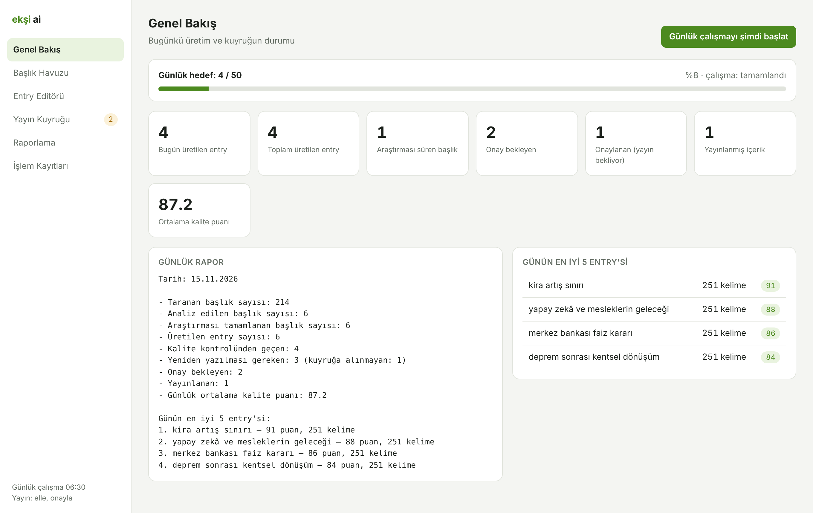
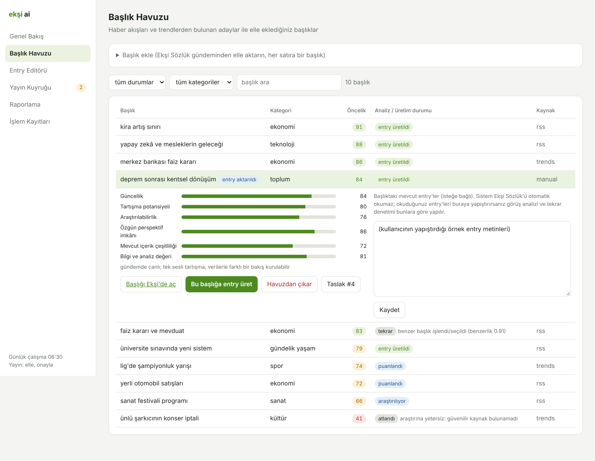
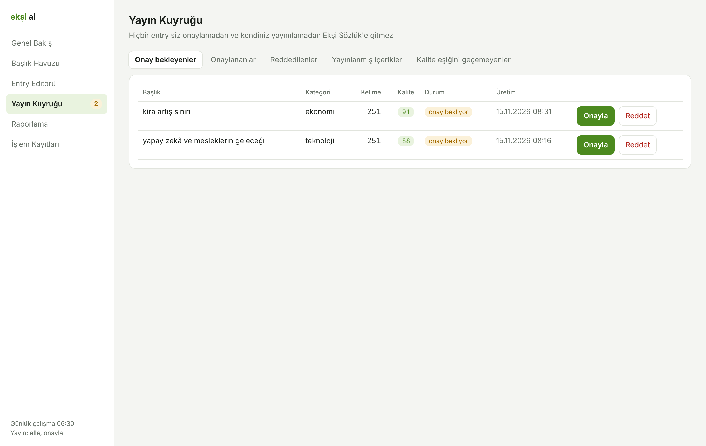
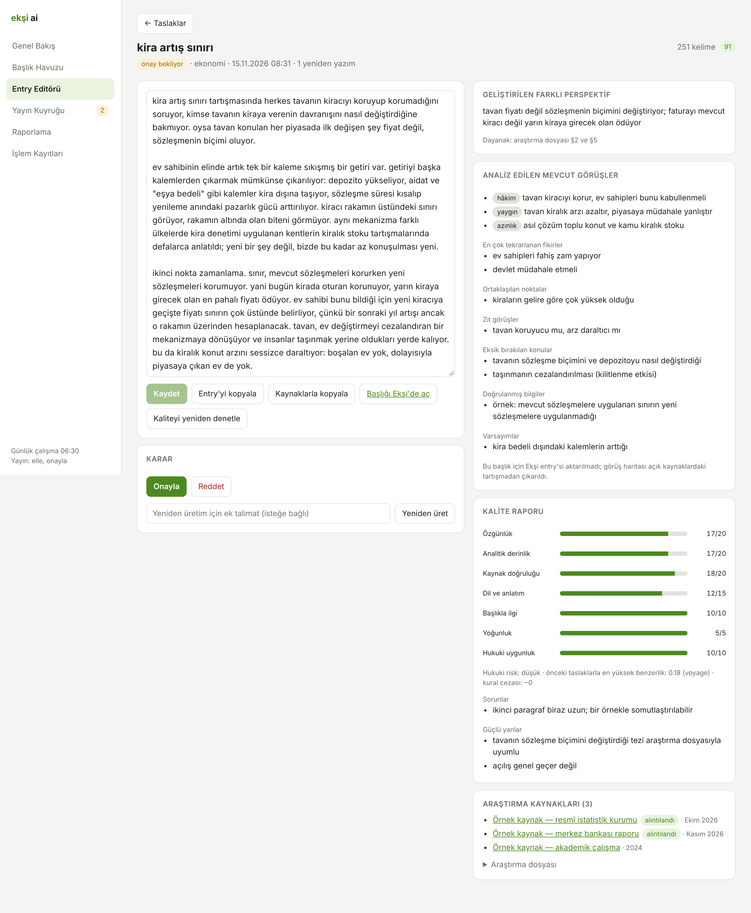
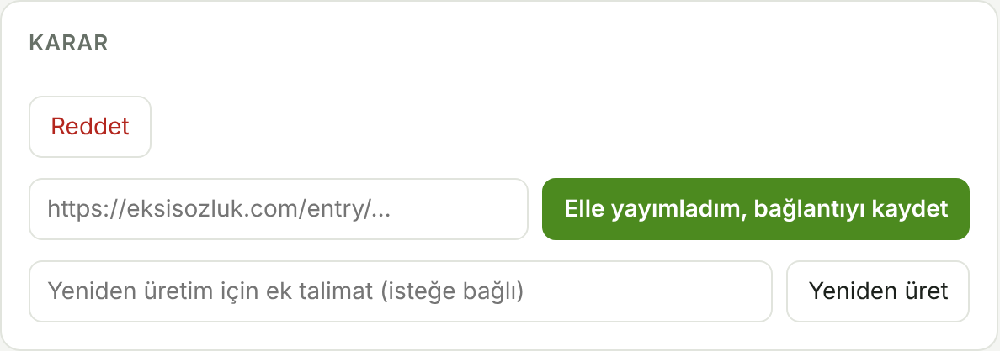
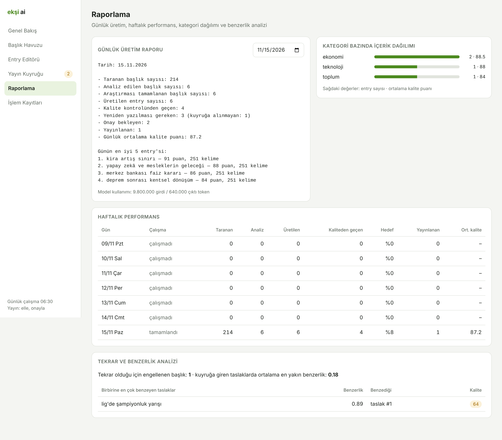
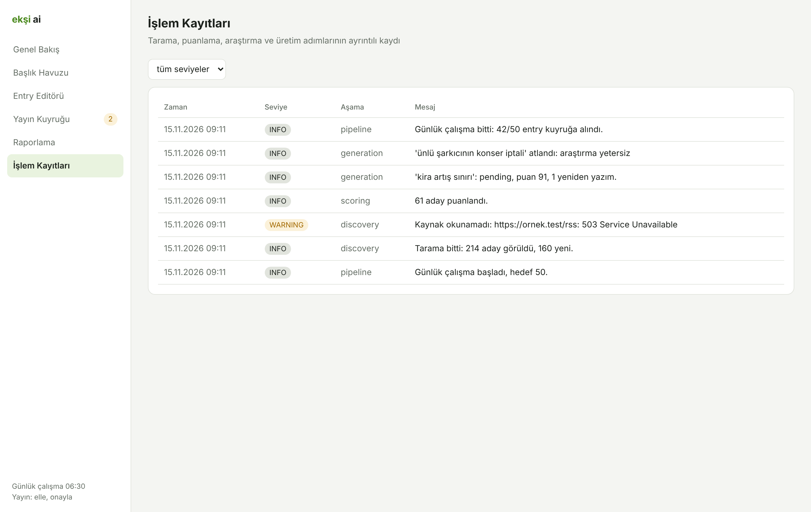
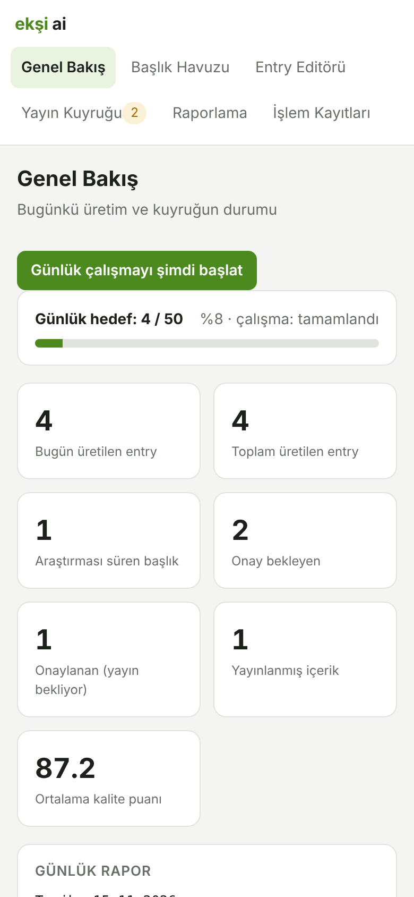

# Ekşi AI – Kullanım Kılavuzu

> **Ekran görüntüleri hakkında:** Aşağıdaki görüntüler, arayüzü göstermek için hazırlanmış
> **örnek veriyle** alınmıştır. Başlıklar, entry metni, kaynaklar ve sayılar gerçek bir
> araştırma ya da gerçek bir çalıştırma değildir. Kaynak adları "Örnek kaynak" olarak
> işaretlidir.

## 1. Sistem ne yapar, ne yapmaz

Her gün 06:30'da (Europe/Istanbul) sunucudaki `worker` çalışır:

1. Haber akışlarını ve Google Trends'i tarar, elle eklediğiniz başlıkları da havuza katar.
2. Adayları 6 ölçütle 100 üzerinden puanlar; birbirine çok benzeyenleri ve son 30 günde işlenmiş
   konuları eler.
3. En yüksek puanlı başlıklardan başlayarak her biri için web araması yapar, tarihli ve
   kaynaklı bir araştırma dosyası çıkarır.
4. Tartışmanın haritasını çıkarır (hâkim görüşler, tekrarlar, boşluklar) ve savunulabilir
   farklı bir bakış açısı seçer. Araştırma yetersizse başlığı **atlar**.
5. Entry'yi yazar; kalite kontrolünden geçirir. 80 altı olanı geri bildirimle yeniden yazar
   (en çok 2 kez); yine geçemezse kuyruğa **almaz**.
6. Taslakları panele koyar. Siz onaylarsınız, siz yayımlarsınız.

**Yapmaz:** eksisozluk.com'a bağlanmaz, oturum açmaz, entry okumaz ya da göndermez. Hesabınızın
kullanıcı adı ve parolası sisteme hiç girilmez.

## 2. İlk kurulum

```bash
cp .env.example .env     # ANTHROPIC_API_KEY, PANEL_TOKEN, POSTGRES_PASSWORD doldurun
docker compose up -d --build
```

- Panel: `http://127.0.0.1:8000`. Uzaktan erişim için SSH tüneli
  (`ssh -L 8000:127.0.0.1:8000 sunucu`) ya da TLS'li bir ters vekil kullanın; paneli doğrudan
  internete açmayın.
- Girişte `.env` içindeki `PANEL_TOKEN` değerini yazın.
- **İlk çalıştırmayı küçük yapın:** `.env` içinde `DAILY_TARGET=5` yapın, paneldeki
  "Günlük çalışmayı şimdi başlat" düğmesine basın, çıkan taslakları ve maliyeti inceleyin.
  Memnun kalınca hedefi artırın.

## 3. Panel turu

Sol menüde altı sayfa var. Sarı rozet, onay bekleyen entry sayısını gösterir.

### 3.1 Genel Bakış



- Üstte günlük hedefin gerçekleşme oranı; altında bugün/toplam üretilen, araştırması süren,
  onay bekleyen, onaylanan, yayınlanan sayıları ve ortalama kalite puanı.
- Sol kutu, istediğiniz formatta **günlük rapor**; sağ kutu günün en iyi 5 entry'si
  (tıklayınca editör açılır).
- "Günlük çalışmayı şimdi başlat" hattı elle başlatır. Aynı gün yeniden başlatırsanız
  hedefe kadar kaldığı yerden devam eder, aynı başlığa tekrar entry üretmez.
- Son çalışma hata verdiyse kırmızı bir uyarı görünür; ayrıntı için İşlem Kayıtları'na bakın.

### 3.2 Başlık Havuzu



- Her başlığın kategorisi, öncelik puanı ve durumu görünür. Bir satıra tıklayınca altı ölçütün
  dökümü ve puanlama gerekçesi açılır.
- **Başlık ekle:** Ekşi gündeminde gördüğünüz başlıkları her satıra bir tane olacak şekilde
  yapıştırın. Elle eklenenler sıradaki çalışmada puanlanır.
- **Mevcut entry'leri yapıştır:** Bir başlığın altında okuduğunuz entry'leri sağdaki kutuya
  yapıştırıp kaydederseniz görüş analizi onlara göre yapılır ve yazılan entry'nin onlardan
  cümle kopyalamadığı denetlenir. Yapıştırmazsanız harita açık kaynaklardaki tartışmadan
  çıkarılır; bu, taslakta belirtilir.
- **Bu başlığa entry üret:** o başlık için hemen üretim başlatır (birkaç dakika sürer).
- **Havuzdan çıkar / geri al:** istemediğiniz başlığı devre dışı bırakır.
- Durumlar: *puanlandı* (sırada), *araştırılıyor*, *entry üretildi*, *atlandı* (nedeni yanında),
  *tekrar* (benzer başlık zaten işlenmiş).

### 3.3 Yayın Kuyruğu



Sekmeler: **onay bekleyenler**, **onaylananlar**, **reddedilenler**, **yayınlanmış içerikler**
(yayın tarihi ve bağlantısıyla) ve **kalite eşiğini geçemeyenler**. Satıra tıklayınca editör
açılır; onay bekleyenlerde satır üzerinden hızlı Onayla/Reddet yapabilirsiniz.

### 3.4 Entry Editörü



Sol tarafta entry'nin kendisi, sağ tarafta nasıl üretildiği:

| Bölüm | Ne gösterir |
|---|---|
| Metin kutusu | Entry; doğrudan düzenleyebilirsiniz. Kelime sayısı canlı güncellenir |
| Geliştirilen farklı perspektif | Entry'nin savunduğu bakış açısı ve dayanağı |
| Analiz edilen mevcut görüşler | Hâkim/yaygın/azınlık görüşler, tekrar eden fikirler, ortak noktalar, zıt görüşler, eksik konular, doğrulanmış bilgiler, varsayımlar, yanlış bilgiler |
| Kalite raporu | 7 ölçütün puanı (özgünlük, derinlik, doğruluk, dil, ilgi, yoğunluk, hukuk), hukuki risk, benzerlik, sorunlar, dayanaksız iddialar |
| Araştırma kaynakları | Arama aracının gerçekten bulduğu kaynaklar; metinde alıntılananlar işaretlidir. "Araştırma dosyası" tam metni açar |

Düğmeler:

- **Kaydet** – elle yaptığınız düzenlemeyi saklar. Kalite puanı eski metne aittir; değişiklikten
  sonra **Kaliteyi yeniden denetle** deyin.
- **Entry'yi kopyala / Kaynaklarla kopyala** – panoya kopyalar (ikincisi sonuna kaynak
  bağlantılarını ekler).
- **Başlığı Ekşi'de aç** – eksisozluk.com'da ilgili başlığı yeni sekmede arar.
- **Yeniden üret** – aynı araştırma ve analizle entry'yi baştan yazdırır. Kutuya ek talimat
  yazabilirsiniz ("daha kısa", "ikinci paragrafa tarihsel bir örnek ekle"). Yeni araştırma
  maliyeti yoktur.
- **Onayla / Reddet** – kararınız. Reddederken neden yazılabilir.

Kalite eşiğini geçemeyen taslağı **elle düzenlemeden onaylayamazsınız**.

### 3.5 Yayımlama (elle)



1. Taslağı **Onayla**.
2. **Entry'yi kopyala**, **Başlığı Ekşi'de aç**, kendi hesabınızla siteye girip entry'yi yazın.
3. Entry yayımlanınca adres çubuğundaki bağlantıyı kutuya yapıştırıp
   **"Elle yayımladım, bağlantıyı kaydet"** deyin. Yalnızca `https://eksisozluk.com/...`
   bağlantıları kabul edilir. Taslak "yayınlandı" olur ve artık düzenlenemez.

Sistem bu adımın hiçbirini sizin yerinize yapmaz.

### 3.6 Raporlama



- **Günlük üretim raporu:** tarih seçerek geçmiş günlere bakabilirsiniz; altında o günün model
  kullanımı (token) yazar, maliyet takibi için kullanın.
- **Kategori dağılımı:** kategori başına entry sayısı ve ortalama kalite.
- **Haftalık performans:** son 7 gün; satıra tıklayınca günlük rapora geçer.
- **Tekrar ve benzerlik:** tekrar nedeniyle engellenen başlık sayısı ve birbirine en çok benzeyen
  taslaklar.

### 3.7 İşlem Kayıtları



Tarama, puanlama, araştırma ve üretimin adım adım kaydı. Bir haber kaynağı okunamazsa,
bir başlık atlanırsa ya da bir hata olursa nedeni burada yazar. **Seviye** filtresiyle yalnızca
hata ve uyarıları görebilirsiniz.

### 3.8 Telefondan



Panel dar ekranlara uyar; telefonda menü üste, kartlar alt alta dizilir. Onay/ret ve okuma için
yeterlidir, uzun metin düzenlemek için bilgisayar daha rahattır.

## 4. Günlük kullanım önerisi

1. Sabah **Genel Bakış**'a bakın: çalışma tamamlandı mı, hata var mı.
2. (İsteğe bağlı) Ekşi gündeminde ilginizi çeken başlıkları **Başlık Havuzu**'na ekleyin,
   önemli olanların altına okuduğunuz entry'leri yapıştırın. Bir sonraki çalışmaya girer;
   hemen istiyorsanız "Bu başlığa entry üret" deyin.
3. **Yayın Kuyruğu → Onay bekleyenler**: en yüksek puanlıdan başlayın. Her taslakta önce
   *kalite raporundaki sorunlara* ve *dayanaksız iddialara*, sonra kaynaklara bakın.
   Rakam ve tarihleri kaynakla karşılaştırmadan yayımlamayın.
4. Beğendiğinizi düzenleyin, onaylayın, elle yayımlayın, bağlantıyı kaydedin.
5. Haftada bir **Raporlama**'da kalite ve tekrar eğilimine ve maliyete bakın.

## 5. Ayarlar (`.env`)

| Ayar | Varsayılan | Anlamı |
|---|---|---|
| `DAILY_TARGET` | 50 | Günlük kuyruğa alınacak hedef entry |
| `DAILY_RUN_HOUR` / `_MINUTE` | 6 / 30 | Çalışma saati (Europe/Istanbul) |
| `QUALITY_THRESHOLD` | 80 | Kuyruğa girmek için asgari kalite puanı |
| `MAX_REWRITES` | 2 | Bir entry için en çok yeniden yazım sayısı |
| `TOPIC_COOLDOWN_DAYS` | 30 | Aynı/benzer konuya yeniden entry üretmeme süresi |
| `PIPELINE_CONCURRENCY` | 3 | Aynı anda işlenen başlık sayısı |
| `MODEL_RESEARCH/WRITER/JUDGE/SCORING` | claude-opus-5-5 | Aşama başına model; maliyeti düşürmek için bazılarını `claude-sonnet-5-5`'e alabilirsiniz |
| `VOYAGE_API_KEY` | boş | Varsa anlamsal benzerlik; yoksa yerel, yüzeysel benzerlik |
| `RSS_FEEDS` | varsayılan liste | Virgülle ayrılmış haber akışı adresleri |

Değişiklikten sonra: `docker compose up -d`.

## 6. Sorun giderme

| Belirti | Neden / çözüm |
|---|---|
| Üstte "ANTHROPIC_API_KEY tanımlı değil" | `.env` içine anahtarı yazıp `docker compose up -d` |
| Giriş ekranı sürekli geliyor | `PANEL_TOKEN` yanlış; `.env` içindeki değeri yazın |
| "Günlük çalışma" 50'ye ulaşmadı | Normal olabilir: yetersiz araştırma, kalite ya da tekrar nedeniyle elenen başlıklar sayılmaz. Nedenler İşlem Kayıtları'nda ve Başlık Havuzu'nda "atlandı" satırlarının yanında |
| "Kaynak okunamadı" uyarıları | O RSS adresi çalışmıyor; `RSS_FEEDS` ile değiştirin |
| Çok sayıda "tekrar" | Normal: benzer konular elenir. Eşiği `TOPIC_DUP_THRESHOLD` ile ayarlayabilirsiniz |
| Taslaklar birbirine benziyor | Voyage anahtarı ekleyin; yerel benzerlik fikir tekrarını yakalamaz |
| Çalışma "çalışıyor" görünüp ilerlemiyor | 45 dakika hareketsizlik sonrası bir sonraki tetikleme devralır; İşlem Kayıtları'nı kontrol edin |

## 7. Sorumluluk

Kalite puanı, hukuki risk ve doğruluk değerlendirmeleri model çıktısıdır; hukuki görüş ya da
doğruluk garantisi değildir. Yayımladığınız her entry'den siz sorumlusunuz. Ekşi Sözlük'ün
güncel kullanıcı sözleşmesini ve yazar kurallarını, özellikle yapay zekâ destekli içerik ve
günlük entry sayısıyla ilgili hükümleri, kullanmaya başlamadan önce kendiniz okuyun.
